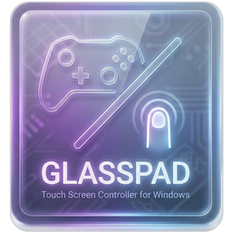

<div align="center">



# GlassPad

**Touchscreen → Gamepad Overlay for Windows**

Turn your touchscreen into a virtual Xbox controller — no hardware required.  
Designed for the **ASUS ROG Flow Z13** and other touch-screen Windows laptops.

[](LICENSE)
[](https://www.microsoft.com/windows)
[](https://dotnet.microsoft.com/)
[](https://ko-fi.com/dansunmi)

</div>

---

<div align="center">

</div>

---

## Features

- **Fully transparent overlay** — touches pass through to the game where no buttons exist
- **Virtual Xbox controller** via HIDMaestro (UMDF2 Windows driver)
- Analog sticks, triggers, bumpers, face buttons, **L3 / R3**, D-pad (4-way / 8-way), guide button
- **D-pad visual feedback** — cyan arm highlights on press; 8-way mode shows a surrounding ring
- **Edit mode** — drag and resize any button, adjust opacity, save layout
- Layout persists across sessions (`%AppData%\GlassPad\layout.json`)
- Driver installs or updates automatically when needed
- Minimal UI — FAB-style control hub, no window chrome

---

## Requirements

| | |
|---|---|
| OS | Windows 11 (22H2 or later recommended) |
| Architecture | x64 |
| .NET | [.NET 10 Desktop Runtime](https://dotnet.microsoft.com/download/dotnet/10.0) |
| Driver | HIDMaestro UMDF2 — installed automatically on first launch |
| Hardware | Any Windows touch-screen device (optimized for ROG Flow Z13) |

> **Administrator privileges are required on every launch** with HIDMaestro 2.x;
> Windows displays an elevation prompt when you open GlassPad.
> The SDK installs or updates its user-mode driver when needed.
>
> **Upgrading from GlassPad v1.0.1:** close the old app first. HIDMaestro 1.x and
> 2.x applications should not run together on the same PC; update other apps using
> HIDMaestro before running them together. The first 2.x launch updates the driver.
> See the upstream [migration notes](https://github.com/hifihedgehog/HIDMaestro/blob/v2.0.3/docs/MIGRATION.md).

---

## Build from Source

```bash
git clone https://github.com/dansunmi/GlassPad.git
cd GlassPad
dotnet build src/GlassPad/GlassPad.csproj -c Release
```

Requires **.NET 10 SDK**. The build references `lib/HIDMaestro/HIDMaestro.Core.dll` (included, MIT licensed).

To create the framework-dependent, single-file Windows build:

```powershell
dotnet publish src/GlassPad/GlassPad.csproj -c Release -p:PublishProfile=Windows
```

The output in `publish/win-x64/` includes `GlassPad.exe`, `GlassPad-LICENSE.txt`,
`HIDMaestro-LICENSE.txt`, and `THIRD-PARTY-NOTICES.txt`. Distribute these together.
The same notices are embedded in the executable and can be read offline from
**About → Open-source licenses**, even when only the EXE is copied.

Run the SDK/profile and axis-allocation checks without installing a driver:

```powershell
dotnet run --project src/GlassPad.PadTest -c Release -- --offline
```

For automated driver and XInput integration checks, open an **elevated terminal**:

```powershell
dotnet run --project src/GlassPad.PadTest -c Release -- --live
```

This installs/updates the driver and exercises the application's actual `PadService`:
buttons, eight D-pad directions, both sticks and triggers, combined input, reset,
100 press/release cycles, disposal and reconnection. It also checks the Xbox 360
fallback profile. Each input is read back through Windows `XInputGetState`.
Guide (outside that API's documented button bits) and physical touchscreen routing
are not covered. Test controllers are disposed when each phase ends.
Optional `--log <path>` saves the results; `--app <absolute-exe-path>` then launches
the published app, verifies its controller connection, and leaves it open.

Without a mode flag, PadTest runs the original manual Xbox 360 smoke test with
five A-button presses for inspection in `joy.cpl`.

---

## Usage

1. Launch `GlassPad.exe` and accept the **Administrator** prompt
2. The overlay appears full-screen and transparent — start your game
3. Tap **≡** at the top-center to open the control hub:

| Button | Action |
|--------|--------|
| **✕** | Quit GlassPad |
| **✎** | Edit layout — drag, resize, opacity slider, save |
| **ℹ** | About, controller status, and open-source licenses |
| **⊘** (hold) | Temporarily disable overlay |

---

## Project Structure

```
src/
  GlassPad/          Main WPF overlay application
    Input/           DpadZone, StickZone, PadService (HIDMaestro wrapper)
    Overlay/         GamepadLayout, LayoutEditor, Win32Helper
    img/             App icon assets
lib/
  HIDMaestro/        HIDMaestro.Core.dll + LICENSE + third-party notices
```

---

## Known Limitations

- **Exclusive fullscreen is not supported.** Use **Windowed** or **Borderless Windowed** mode in your game settings. In exclusive fullscreen, the game takes over the entire display and the overlay cannot render on top of it.

- **Simultaneous button presses may not register correctly.** Due to a WPF touch-routing limitation, two buttons pressed at the exact same instant can sometimes be missed. This is a known issue currently under investigation. **Workaround:** press the second button ~0.1 seconds after the first — inputs staggered slightly this way work reliably.

- **Controller not recognized by the game?** Close GlassPad and relaunch it — this re-initializes the virtual controller and usually resolves the issue.

---

## Changelog

### v1.0.2
- Embed license texts and show them in **About → Open-source licenses**; include them in publish output
- Upgrade HIDMaestro from **1.3.15 to 2.0.3**, including its third-party notices
- Reuse the axes dictionary and cache profile axis keys instead of allocating per input
- Serialize input submission and disposal, and release controllers if the app closes during startup
- Show controller initialization status/errors and assembly versions in About

### v1.0.1
- Added **L3 / R3** buttons (left/right stick click) next to LB/RB

### v1.0.0
- Initial release

---

## Credits

- **[HIDMaestro SDK v2.0.3](https://github.com/hifihedgehog/HIDMaestro/releases/tag/v2.0.3)** — virtual controller driver ([MIT License](lib/HIDMaestro/LICENSE), [third-party notices](lib/HIDMaestro/THIRD-PARTY-NOTICES.txt))
- Built with C# / .NET 10 / WPF

---

## Support

If GlassPad is useful to you, consider buying me a coffee!

[](https://ko-fi.com/dansunmi)

Blog: [blog.rpm.moe](https://blog.rpm.moe/)

---

## License

MIT — see [LICENSE](LICENSE)
